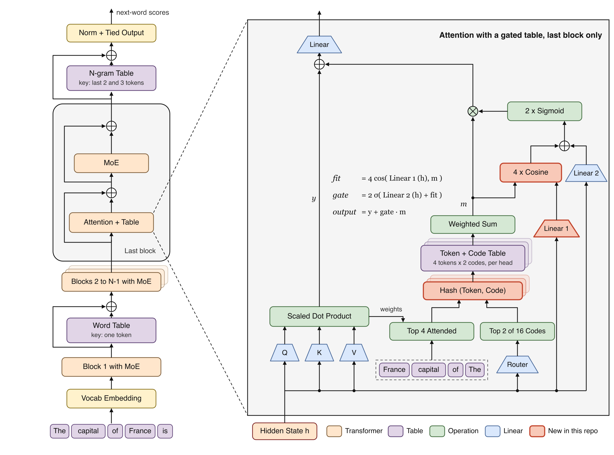
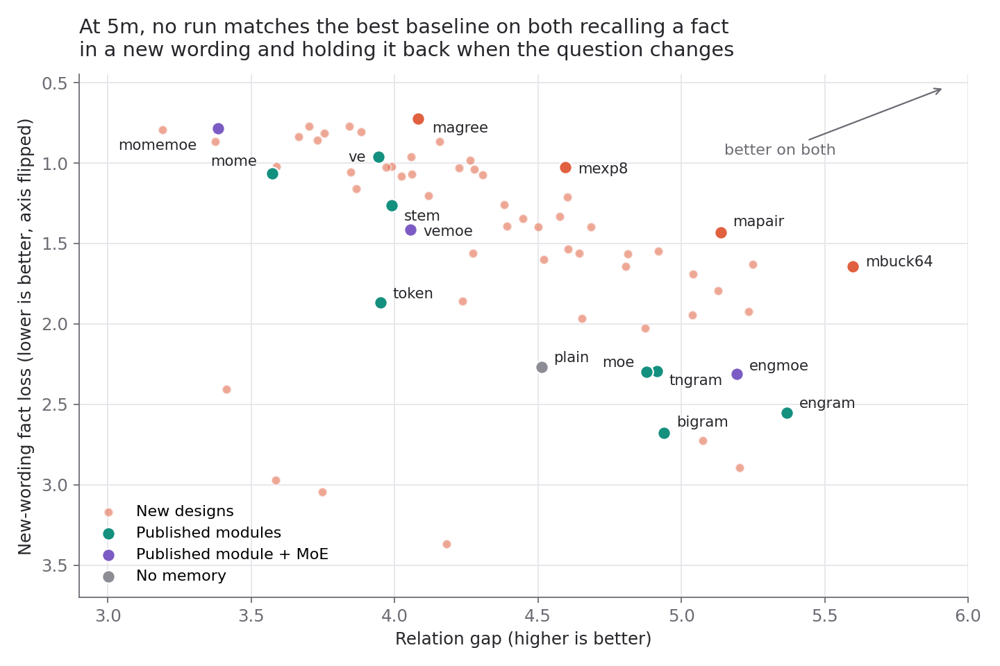

# Free ICML research: LLM memory modules and a test to compare them

> [!IMPORTANT]
> **This is giveaway research for ICML 2027.** It was made in our school, [AI Research School](https://www.skool.com/become-ai-researcher-2669), and it is open to anybody. Take the code, the results or the ideas and publish your own paper. You need no permission and you do not need to add anyone as an author.
>
> A memory module gives an LLM a learned table to look things up in. This repo tests 9 published modules and about 90 new designs on the same text at several sizes. The largest size so far has about 43M weights. **At that size, the design below has the lowest web loss of the 21 modules tested and ties the best published modules on fact recall. It loses one score, the relation gap.**


**`mmomez`, the best design at the largest size so far.** Left: the whole model. Right: attention in its last block. The words are an example. Every part follows a published module, and the one change is in coral: the n-gram table's output starts at zero.

### How the model uses the text so far to choose what to add

This is the MoME part of the figure, in the last block, with the sizes of the model above.

Each of the 20,000 tokens in the vocabulary has its own 8 learned vectors, each 1/8 the size of the token embedding. In attention, for every token, each head uses the text so far to pick 2 of that token's vectors, mix them and add them to that token's value, so the same word can add something different in a different sentence.

For example, "France" might learn one vector that pushes the model toward "Paris", one toward "euro" and one toward "French". In "The capital of France is", a head could pick the "Paris" vector, and in "The currency of France is", the "euro" vector. This is only an illustration, because we haven't checked what the vectors really hold.

It doesn't fully work yet: a simpler model with no memory table is still better at ignoring facts the question didn't ask for.

---

## Memory modules add a lookup table to the model

A language model reads a sentence and passes a hidden state from block to block. Whatever it remembers has to be stored in its weights and reached through that state.

A **memory module** adds a learned table. The model finds a row using the current token or the last few tokens, then adds that row to the computation.

Say the model has read "The capital of France is" many times. A table keyed on "France" can learn a row that pushes up "Paris".

Now ask "The currency of France is". A row keyed on "France" still pushes up "Paris". The **relation gap** measures this: how much more likely is the stored answer under its own question than under another relation's question?

---

## Which modules work, and why

### Try `mmomez` for text prediction, because it has the lowest web loss at the largest size

Tier 1h is a model 256 wide with 6 layers, trained for 10,000 steps. Lower is better, except for the relation gap. The bracket says how many standard errors `mmomez` is from the best published module on that score, and positive means better. A gap under 2 standard errors is a tie, so all three fact scores tie.

| Score | Engram | Best published module | `mmomez` |
|---|---|---|---|
| Web loss | 4.604 | 4.591 MoME | **4.550 (+14.3)** |
| Stored facts | .127 | .084 Bigram | .091 (-.4) |
| Facts in new wording | 3.299 | 1.417 STEM | 1.370 (+.5) |
| Name far from the answer | 3.839 | 1.825 STEM | 1.706 (+1.4) |
| Relation gap | 4.757 | **6.041 MoE alone** | 4.383 (-14.4) |
| Usual phrase | 1.456 | 1.456 Engram | **1.410 (+4.8)** |

The model has four additions on top of a plain transformer, and all of them fit in Engram's weight budget:

1. **MoE runs in every block.** Its extra weights come out of the table budget.
2. **A word table sits after block 1.** It has one row per token.
3. **MoME sits in the last block.** Each token has 8 slots. Each attention head uses the hidden state to pick 2 of them and adds them to its values.
4. **An n-gram table sits after the last block.** It is Engram's table, keyed on the last 2 and 3 tokens, with its output starting at zero.

MoE alone and MoME alone each lower web loss, and the parts together go lower:

| Model at 1h | Weights | Web loss |
|---|---|---|
| Plain | 9.84M | 4.656 |
| MoE alone | 14.55M | 4.620 |
| MoME alone | 25.25M | 4.591 |
| MoME + MoE | 29.96M | 4.562 |
| `tmomez`: word table, MoME, n-gram table | 43.55M | 4.570 |
| **`mmomez`: those three tables + MoE** | **43.30M** | **4.550** |

> **Adding MoE to the three tables lowers web loss by .02 with no extra weights, because MoE takes them from the tables.**

These models have different weights, so this table does not show which part is worth its size. MoME + MoE uses only published parts and has 13M fewer weights than `mmomez`. It gets most of the web gain over MoME alone, so the word and n-gram tables add .012 of web loss (4.7 standard errors). They add more on facts: new wording is 1.370 with them and 2.038 without.

`mmomez` costs 1.31x Engram's time per step, measured at 5m on one CPU thread.

### Try `magree` for fact recall, because three tables each do a different job



`magree` has the same layout as `mmomez`, with a gated table in place of MoME. At 1h it has the best stored facts (.062, +2.2) and name far (1.605, +2.5) of any model here, web loss 4.558 (+12.2) and relation gap 4.245 (-15.4). Its lead is larger at 5m, shown below. Tier 5m is a model 96 wide with 4 layers, trained for 1500 steps.

| Score | Engram | Best published module | `magree` |
|---|---|---|---|
| Web loss | 5.408 | 5.386 MoME | **5.365 (+4.7)** |
| Stored facts | .633 | .224 value embeddings | **.098 (+5.0)** |
| Facts in new wording | 2.553 | .962 value embeddings | **.724 (+2.3)** |
| Name far from the answer | 3.324 | 1.784 value embeddings | **1.068 (+8.3)** |
| Relation gap | 5.368 | **5.368 Engram** | 4.082 (-8.4) |
| Usual phrase | 1.595 | 1.595 Engram | 1.567 (+1.0) |

Each part was switched off in a trained model to see what it does. These tests ran on `magree` at 5m, and they have not run on `mmomez` or at 1h. Scores are log-probabilities of the stored answer, and all tables on gives -1.40 under its own question and -5.48 under another relation's question.

1. **The word table gives the most recall.** Without it, the right answer falls by 3.21 to -4.61.
2. **The gated table adds recall, and it also leaks.** Each attention head takes the 4 tokens it attended to most and uses its own state to pick 2 of 16 codes. A row is found by token and code. Without this table, the right answer falls by 2.32 and the wrong one falls by 3.42.
3. **The n-gram table protects the relation gap.** Without it, the gap falls from 4.08 to 2.56.

> **The word table and the gated table raise the right answer, and they also raise that answer under the wrong question. Only the n-gram table holds it back.**

The cosine in the gate helps only at the larger size. Against `mtrip`, the same design without the cosine, `magree` gains 3.8 standard errors on new wording at 5m and loses 2.5 at 1m.

### Use a different module for other jobs

Results are at 1h unless the row says otherwise, in standard errors from the best published module.

| Job | Try | Result | Weights |
|---|---|---|---|
| Lowest web loss | `mmomez` | Web 4.550 (+14.3), relation gap (-14.4) | 43.30M |
| Web loss and stored facts | `mmixz`: `mmomez` with half its slots keyed by token and half by last 2 tokens | Web 4.553 (+13.2), stored .065 (+1.7), relation gap (-17.8) | 43.30M |
| Fact recall | `magree` | Stored .062 (+2.2), name far 1.605 (+2.5), relation gap (-15.4) | 43.38M |
| Low web loss with published parts only | MoME + MoE | Web 4.562 (+10.9), new wording (-5.2), relation gap (-15.7) | 29.96M |
| Highest relation gap with a table, at 5m | `mbuck64`: rows keyed by token and a bucket of another token | Gap 5.598 (+1.6), new wording (-6.0) | 4.74M at 5m |
| Highest relation gap | MoE alone, published | Gap 6.041, web 4.620 | 14.55M |
| Low web loss, published | MoME | Web 4.591 | 25.25M |
| New wording and far names, published | STEM | 1.417 and 1.825 | 50.23M |
| Stored facts, published | Bigram | .084 | 25.21M |
| Usual phrase, published | Engram | 1.456 | 43.54M |

At 5m, more relation gap tends to come with worse new-wording loss, and no run there has both:



### Trust 1h over 5m, because some 5m leads fade

`mtrip` is the closest design to `magree` that has run at both sizes. This is how far it sits from the best published module, and positive means better:

| Score | At 5m | At 1h |
|---|---|---|
| Web loss | +.015 | +.026 |
| Usual phrase | +.025 | +.043 |
| Stored facts | +.130 | +.002 |
| Name far from the answer | +.496 | +.035 |
| Facts in new wording | -.075 | -.124 |
| Relation gap | -1.089 | -1.875 |

> **The lead on text prediction grows with size. The lead on fact recall almost disappears.**

The published modules change order too. This is the rank correlation of the 9 published modules between 5m and 1h, where 1.0 means the same order: name far .82, usual phrase .80, web loss .68, new wording .63, stored facts .52, relation gap .30. A plain table with one row per token is 3rd on web loss at 5m and 8th at 1h, and Engram is 1st on relation gap at 5m and 5th at 1h.

### Read the win rule as a target, because no module passes it

`beat.py` applies a rule that was written before the new designs ran. At both 1m and 5m, a design must have the lowest web loss by 2 standard errors, lose none of the other 5 scores to a published module by 2 standard errors, and use no more weights than Engram.

None of the 9 published modules passes it against the other 8, at 1m, 5m or 1h. They lead on different scores, and the new designs fail it the same way. So a module can be useful and still fail, and [RESULTS.md](RESULTS.md) gives every score for you to judge.

---

## What is new here, and what comes from papers

> **`mmomez` adds no new part: you can claim a new combination. `magree` adds two small changes to known parts. You cannot yet claim that nobody did this first.** Three extended searches found no earlier version, and most close papers have not been read in full.

| Part | Where it comes from | Status here |
|---|---|---|
| MoE | Standard in current models | Used as published |
| Table with a gate, added to the hidden state | Engram, 2601.07372 | Word table and n-gram table reuse its read path |
| Table in attention, router, top 2 slots | MoME, 2609.15126 | `magree` adds its row after attention instead of to the values. Memory Attention 2609.28399 tests both and finds values better |
| MoE with Engram, MoME with Bigram | Lngram 2605.24869, MoME Table 4 | Published pairs of parts |
| **N-gram table with its output starting at zero** | Engram, 2601.07372, with a changed start | Small change, in `mmomez` and `magree` |
| **Router code inside the table key, picked by the reading head** | Not found | New here, as far as the searches show |
| **Gate from a cosine between the hidden state and the row** | Close to Engram's gate section 2.3 | Small change: per head, on attention output, cosine |
| **Word table, gated table, n-gram table and MoE, at these depths in one budget** | Not found | New combination |
| **One test with fact, wording, relation and text scores** | Not found. ROME and CounterFact (2202.05262) may be close, from training data and not checked | New test, to be checked |

The ports follow the papers' text, and they have not been compared with the authors' code.

---

## Pick any of these research directions

There is room for many separate papers. [PAPER-IDEA.md](PAPER-IDEA.md) has more directions, a draft abstract and what a reviewer will ask.

1. **Fix the leak.** Can a table recall a fact in new wording and hold it back when the question changes?
2. **Change the key.** `magree` recalls and `mbuck64` protects the gap. Can a key do both?
3. **Change the gate.** What should a gate read so that it closes under the wrong relation?
4. **Move the tables.** Which block should each table sit in, and does that change with size?
5. **Split the budget.** How should weights divide between the tables and MoE as the model grows?
6. **Make it cheap.** Can the gated table keep its gain below 1.40x Engram's step time?
7. **Explain the size flips.** Why does module order change with size, and does tokens per table row predict it?
8. **Test bigger models.** Do scores at small sizes predict the order at 5h and beyond?

---

## Where it stops working

> [!WARNING]
> - **Small models.** Every result comes from models of about 50M weights or fewer. The 5h tier (512 wide, 8 layers) has settings in `env.py` and has never run.
> - **Most of `mmomez`'s web lead comes from published parts.** Web loss is 4.591 for MoME alone, 4.562 for MoME + MoE and 4.550 for `mmomez`.
> - **It costs more compute.** `mmomez` takes 1.31x Engram's time per step and `magree` 1.40x, and a run that gives Engram the same time has not been done.
> - **One training run per setting.** Standard errors cover the test items and do not cover the change between training runs.
> - **Hidden test items are mostly unused.** Their scores have been read only for baselines, `tmomez` and `tmixz`. The 1h job also scored `magree`, `mexp8` and the MoE controls on them, and nobody has read those scores. `mmomez` has not been scored on them.
> - **Even the plain model beats it on the relation gap.** At 1h `mmomez` scores 4.383 and a model with no memory scores 5.406.
> - **Published gaps are out of reach.** This test can judge large gaps between modules. It can't judge published gaps of about .001, and published benchmarks sit near chance at these sizes.
> - **Fact scores depend on lr.** At 5m their module rankings flip between lr .01 and .02.
> - **Nothing shows that these small models predict large ones.**

An AI coding agent wrote the code, ran the experiments and wrote these documents. They have had no peer review, so check everything before you rely on it.

---

## Setup

```bash
pip install -r requirements.txt
```

```bash
python3 setup_data.py
```

```bash
python3 env.py --method engram --tier 5s --lr 0.02
```

The download is 392 MB and takes a few minutes. The last command trains in about a minute on one CPU core and prints its scores. To read the existing results, you need neither the data nor training: `python3 tables.py 5m`.

## More

- [SETUP.md](SETUP.md): install, tiers, free Kaggle GPU, adding your own module.
- [RESULTS.md](RESULTS.md): every score, the win rule, controls and speed.
- [EXPERIMENTS.md](EXPERIMENTS.md): the full log with each prediction and result, small debugging experiments, and the bugs found.
- [PAPER-IDEA.md](PAPER-IDEA.md): research directions, a draft abstract and what is missing.

MIT licence. The downloaded data has its own licences, see [SETUP.md](SETUP.md).
