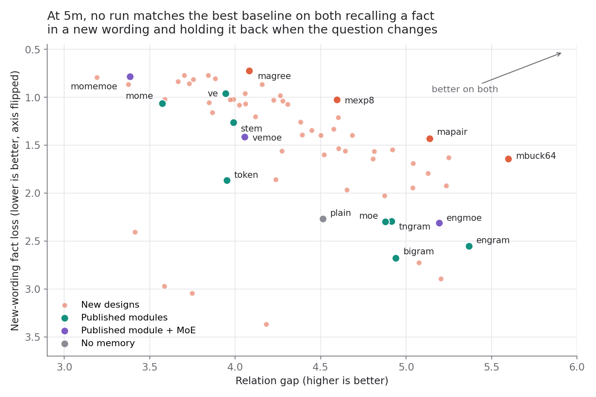
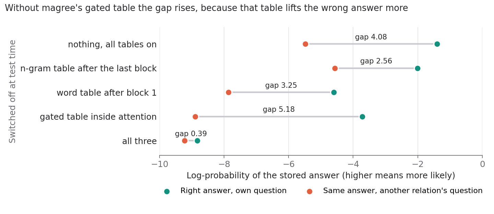

# Results

Score tables come from `results.jsonl`, and the commands at the end print them again. Speed and switch-off numbers come from the scripts in `debug/`. Each setting has one training run.

## Read these six scores first

The training text is fresh web text, each token read once, plus 10% planted fact sentences from ParaRel. A fact appears 2, 8 or 32 times in training. Lower is better on every score except the relation gap.

| Score | Name in the code | What it asks |
|---|---|---|
| **Web loss** | `text.web.loss` | How well does the model predict the next token of web text it never saw? |
| **Stored facts** | `facts.stored.copies32.nll` | Fact written 32 times, asked in the same wording: loss on the answer. |
| **New wording** | `facts.new-wording.copies32.nll` | The same fact, asked in a wording never seen in training. |
| **Name far** | `facts.new-wording.name-far.nll` | New wording where the name sits far from the answer. |
| **Relation gap** | `changed.other-relation.gap` | Log-probability of the stored answer under its own question, minus under another relation's wording. High means the model holds the answer back when the question changes. |
| **Usual phrase** | `ambiguous.usual.loss` | A phrase with several continuations: loss on the most common one. |

**Standard errors.** The number in brackets is z, the gap to the best baseline in standard errors, item by item. A positive z means the design is better. Items are the same for all methods, so gaps are compared row by row.

> [!WARNING]
> z only says how much a gap depends on which test items were used. Each setting has one training run, so z does not include how much a score changes between training runs. For scale, changing only the lr moved `tmix` at 1m from web 5.453 to 5.462.

**Learning rate.** Baselines ran at lr .01 and .02, and also .04 at 1m, except `moe` at 5m, which ran at .01 only. The lr with the lowest loss on separate tuning rows is the one reported. **Many designs ran at only one lr:** 43 of 70 methods at 5m, including `mexp8` and `mbuck64`, ran at .01 only. `magree`, `mapair` and the controls ran at both.

---

## Judge a design with a rule written before it ran

The win rule in [beat.py](beat.py) was written before any new design ran. At the lr the tuning rows pick, at both 1m and 5m:

1. Web loss is below every baseline's by at least 2 standard errors.
2. On the 5 other scores above, no baseline is better by 2 standard errors or more.
3. Total weights are no more than Engram's.

The rule caps weights and not compute. See [the speed table](#count-compute-too-because-the-win-rule-only-caps-weights).

---

## No design passes the win rule

About 90 designs ran, counting table-size variants. `magree` is the closest on facts and `mbuck64` is the closest on the relation gap. Each one fails a different part of the rule.

### At 5m, `magree` leads on web text and facts and loses the relation gap

| design, lr | weights | web loss | stored facts | new wording | name far | relation gap | usual phrase |
|---|---|---|---|---|---|---|---|
| baseline best | | 5.386 mome | 0.224 ve | 0.962 ve | 1.784 ve | 5.368 engram | 1.595 engram |
| magree 0.01 | 4.75M | 5.365 (+4.7) | 0.098 (+5.0) | 0.724 (+2.3) | 1.068 (+8.3) | 4.082 (-8.4) | 1.567 (+1.0) |
| mexp8 0.01 | 4.76M | 5.365 (+4.9) | 0.169 (+1.7) | 1.026 (-0.8) | 1.630 (+1.8) | 4.595 (-5.3) | 1.591 (+0.1) |
| mapair 0.01 | 4.74M | 5.367 (+4.3) | 0.261 (-1.1) | 1.430 (-5.1) | 2.433 (-7.1) | 5.137 (-1.7) | 1.583 (+0.5) |
| mbuck64 0.01 | 4.74M | 5.378 (+1.8) | 0.279 (-1.7) | 1.644 (-6.0) | 2.377 (-6.3) | 5.598 (+1.6) | 1.578 (+0.7) |
| mtrip 0.01 | 4.74M | 5.371 (+3.4) | 0.094 (+5.2) | 1.037 (-0.6) | 1.288 (+5.3) | 4.279 (-7.2) | 1.570 (+1.0) |
| tmomez 0.01 | 4.73M | 5.368 (+3.9) | 0.111 (+3.9) | 0.838 (+1.8) | 1.480 (+3.7) | 3.665 (-12.1) | 1.544 (+2.4) |
| tmixz 0.01 | 4.73M | 5.366 (+4.6) | 0.104 (+5.3) | 1.161 (-2.0) | 1.623 (+1.7) | 3.867 (-10.3) | 1.534 (+2.3) |

> **`magree` beats every baseline on web loss, stored facts, new wording and far names at 5m, and loses the relation gap by 8.4 standard errors, even to the plain model with no memory (4.082 against 4.512).**



More relation gap tends to come with worse new-wording loss. `mbuck64` has the best gap of the designs, and its web lead is under 2 standard errors. `magree` has the best new wording and a low gap. No run reaches the corner with both. The chart leaves out `nmtrip1`, `nmtrip5`, `nplain` and `bigram6`, whose new-wording loss is above 4.5. They are in the full table below.

### At 1m, `magree` has no web lead at all

| design, lr | weights | web loss | stored facts | new wording | name far | relation gap | usual phrase |
|---|---|---|---|---|---|---|---|
| baseline best | | 5.466 token | 0.635 mome | 2.091 mome | 3.011 mome | 4.395 bigram | 1.715 token |
| magree 0.01 | 1.76M | 5.466 (-0.1) | 0.490 (+1.9) | 2.582 (-1.9) | 3.120 (-0.6) | 3.627 (-3.5) | 1.662 (+1.1) |
| mtrip 0.01 | 1.75M | 5.458 (+1.0) | 0.294 (+5.2) | 2.162 (-0.3) | 2.758 (+1.5) | 3.864 (-2.4) | 1.613 (+2.0) |
| mapair 0.01 | 1.75M | 5.459 (+1.1) | 1.371 (-5.7) | 3.705 (-4.9) | 4.303 (-5.9) | 4.223 (-0.9) | 1.651 (+1.1) |
| mbuck64 0.01 | 1.75M | 5.481 (-2.3) | 1.395 (-5.7) | 3.258 (-4.7) | 4.051 (-5.6) | 4.571 (+1.0) | 1.624 (+2.0) |

> **The 5m lead of `magree` does not hold at 1m: web loss ties, and the relation gap loses by 3.5 standard errors.** `mapair` also changes a lot with size: its stored-fact loss is .261 at 5m and 1.371 at 1m.

---

## Add MoE to a published module before crediting a new design

The `m...` designs carry MoE (mixture of experts, 1 shared expert plus the top 2 of 8 in every block), and of the baselines only `moe` has it. So a gain could come from MoE. These three controls use published parts only and ran after the designs:

| design, lr | weights | web loss | stored facts | new wording | name far | relation gap | usual phrase |
|---|---|---|---|---|---|---|---|
| baseline best | | 5.386 mome | 0.224 ve | 0.962 ve | 1.784 ve | 5.368 engram | 1.595 engram |
| engmoe 0.02 | 4.73M | 5.407 (-4.3) | 0.607 (-8.3) | 2.310 (-8.4) | 3.123 (-13.8) | 5.193 (-1.4) | 1.606 (-0.5) |
| vemoe 0.02 | 4.34M | 5.389 (-0.6) | 0.467 (-5.2) | 1.415 (-5.0) | 2.530 (-8.3) | 4.056 (-9.4) | 1.690 (-3.8) |
| momemoe 0.01 | 4.35M | 5.379 (+1.8) | 0.179 (+1.8) | 0.786 (+2.2) | 1.450 (+4.3) | 3.385 (-13.5) | 1.665 (-2.5) |
| magree 0.01 | 4.75M | 5.365 (+4.7) | 0.098 (+5.0) | 0.724 (+2.3) | 1.068 (+8.3) | 4.082 (-8.4) | 1.567 (+1.0) |

> **`momemoe` uses only published parts and 8% fewer weights, and it already beats every baseline on new wording and far names, so part of `magree`'s fact gain is not new.** `magree` still beats it directly: web z +2.8, stored +2.9, far names +4.7, relation gap +5.4, usual phrase +3.7. New wording ties (+.5).

`magree` against Engram + MoE: web +8.6, stored +9.1, new wording +9.7, far names +16.0, usual phrase +1.3, relation gap -7.5.

MoE + Engram is already published (Lngram, 2605.24869), so `engmoe` is a known combination.

---

## Read each score separately, because no published module leads on all of them

Baselines at their tuned lr, 5m:

| method | lr | weights | web loss | stored facts | new wording | name far | relation gap | usual phrase |
|---|---|---|---|---|---|---|---|---|
| plain | 0.01 | 1.60M | 5.434 | 0.852 | 2.268 | 2.970 | 4.512 | 1.773 |
| token | 0.01 | 4.81M | 5.394 | 0.513 | 1.868 | 2.743 | 3.950 | 1.694 |
| engram | 0.02 | 4.76M | 5.408 | 0.633 | 2.553 | 3.324 | 5.368 | 1.595 |
| moe | 0.01 | 2.04M | 5.425 | 0.816 | 2.298 | 2.918 | 4.879 | 1.752 |
| ve | 0.01 | 3.90M | 5.393 | 0.224 | 0.962 | 1.784 | 3.943 | 1.689 |
| mome | 0.01 | 3.90M | 5.386 | 0.293 | 1.064 | 2.020 | 3.573 | 1.693 |
| stem | 0.01 | 7.69M | 5.401 | 0.390 | 1.262 | 2.210 | 3.991 | 1.705 |
| bigram | 0.01 | 3.90M | 5.410 | 0.599 | 2.677 | 3.498 | 4.939 | 1.615 |
| tngram | 0.02 | 4.76M | 5.428 | 0.555 | 2.294 | 3.020 | 4.915 | 1.695 |

- **Facts:** VE and MoME lead, at 3.90M weights. Engram has 4.76M weights and much worse facts.
- **Relation gap and usual phrases:** Engram leads. MoME has the worst relation gap.
- **Fact rankings depend on lr at 5m.** See [the audit](#trust-large-gaps-and-do-not-trust-small-ones).

At 1m:

| method | lr | weights | web loss | stored facts | new wording | name far | relation gap | usual phrase |
|---|---|---|---|---|---|---|---|---|
| plain | 0.01 | 0.71M | 5.530 | 2.152 | 3.569 | 4.062 | 2.847 | 1.910 |
| token | 0.02 | 1.78M | 5.466 | 1.464 | 3.012 | 3.783 | 3.534 | 1.715 |
| engram | 0.01 | 1.77M | 5.523 | 1.653 | 4.100 | 4.538 | 4.318 | 1.775 |
| moe | 0.01 | 0.90M | 5.539 | 1.527 | 3.124 | 3.746 | 3.396 | 1.914 |
| ve | 0.01 | 1.73M | 5.481 | 0.902 | 2.370 | 3.315 | 3.509 | 1.769 |
| mome | 0.01 | 1.74M | 5.471 | 0.635 | 2.091 | 3.011 | 3.419 | 1.731 |
| stem | 0.01 | 3.41M | 5.493 | 1.825 | 3.840 | 4.317 | 3.402 | 1.780 |
| bigram | 0.01 | 1.73M | 5.502 | 1.944 | 4.064 | 4.492 | 4.395 | 1.725 |
| tngram | 0.01 | 1.76M | 5.543 | 1.443 | 3.246 | 3.856 | 3.950 | 1.893 |

At 5s:

| method | lr | weights | web loss | stored facts | new wording | name far | relation gap | usual phrase |
|---|---|---|---|---|---|---|---|---|
| plain | 0.01 | 0.25M | 5.656 | 2.384 | 2.519 | 3.133 | 1.317 | 2.590 |
| token | 0.01 | 0.45M | 5.567 | 2.682 | 3.238 | 3.658 | 1.107 | 2.210 |
| engram | 0.01 | 0.45M | 5.635 | 2.056 | 2.545 | 3.507 | 2.341 | 2.215 |
| moe | 0.01 | 0.30M | 5.663 | 2.762 | 2.943 | 3.447 | 1.118 | 3.020 |
| ve | 0.01 | 0.44M | 5.593 | 2.346 | 2.883 | 3.478 | 0.822 | 2.559 |
| mome | 0.01 | 0.44M | 5.613 | 2.088 | 2.181 | 3.056 | 1.155 | 2.506 |
| stem | 0.01 | 0.75M | 5.615 | 2.309 | 2.782 | 3.466 | 1.252 | 2.511 |
| bigram | 0.01 | 0.44M | 5.635 | 1.841 | 2.236 | 3.317 | 2.529 | 2.171 |
| tngram | 0.01 | 0.43M | 5.648 | 3.109 | 3.175 | 3.634 | 0.804 | 2.720 |

---

## Test larger sizes, because some leads reverse

At 1h (width 256, 6 layers, 10000 steps, weight limit 43.54M):

| method | lr | weights | web loss | stored facts | new wording | name far | relation gap | usual phrase |
|---|---|---|---|---|---|---|---|---|
| plain | 0.01 | 9.84M | 4.656 | 0.442 | 2.375 | 3.244 | 5.406 | 1.577 |
| token | 0.02 | 44.61M | 4.641 | 0.321 | 2.129 | 2.734 | 5.122 | 1.539 |
| engram | 0.01 | 43.54M | 4.604 | 0.127 | 3.299 | 3.839 | 4.757 | 1.456 |
| moe | 0.01 | 14.55M | 4.620 | 0.283 | 1.817 | 2.555 | 6.041 | 1.548 |
| ve | 0.01 | 25.20M | 4.601 | 0.120 | 1.689 | 2.228 | 4.721 | 1.506 |
| mome | 0.02 | 25.25M | 4.591 | 0.105 | 2.144 | 2.275 | 4.152 | 1.504 |
| stem | 0.01 | 50.23M | 4.615 | 0.097 | 1.417 | 1.825 | 4.467 | 1.503 |
| bigram | 0.02 | 25.21M | 4.611 | 0.084 | 2.480 | 3.079 | 4.361 | 1.478 |
| tngram | 0.01 | 44.03M | 4.619 | 0.170 | 3.599 | 3.882 | 5.249 | 1.509 |

- STEM leads new wording and far names at 1h, and it led neither at 5m. It has 50.23M weights there, above Engram's 43.54M.
- MoE leads the relation gap at 1h (6.041). Its weights are about a third of Engram's.

### Compare with a single-token table, and do it at more than one size

`token` has one row per token and no n-grams, with Engram's table weights. On web loss, row by row:

| Tier | `token` | `engram` | z, negative means `token` is better |
|---|---|---|---|
| 1m | 5.466 | 5.523 | -7.9 |
| 5m | 5.394 | 5.408 | -2.9 |
| 1h | 4.641 | 4.604 | +11.9 |

> **A single-token table beats Engram on web loss at 1m and 5m, and Engram beats it at 1h. So the order at small tiers does not carry over to 1h.**

`token` has 44.61M weights at 1h, 2.5% above Engram's 43.54M.

### At 1h the designs lead on web text and lose the relation gap by a wide margin

| design, lr | weights | web loss | stored facts | new wording | name far | relation gap | usual phrase |
|---|---|---|---|---|---|---|---|
| baseline best | | 4.591 mome | 0.084 bigram | 1.417 stem | 1.825 stem | 6.041 moe | 1.456 engram |
| mmomez 0.01 | 43.30M | 4.550 (+14.3) | 0.091 (-0.4) | 1.370 (+0.5) | 1.706 (+1.4) | 4.383 (-14.4) | 1.410 (+4.8) |
| mmixz 0.01 | 43.30M | 4.553 (+13.2) | 0.065 (+1.7) | 1.422 (-0.0) | 1.695 (+1.2) | 3.830 (-17.8) | 1.413 (+5.0) |
| mtrip 0.01 | 43.31M | 4.565 (+9.3) | 0.082 (+0.2) | 1.541 (-1.2) | 1.790 (+0.4) | 4.166 (-16.0) | 1.413 (+4.4) |
| mpair 0.01 | 43.28M | 4.581 (+3.4) | 0.079 (+0.4) | 1.363 (+0.5) | 1.803 (+0.3) | 4.356 (-14.7) | 1.426 (+3.4) |
| ttrip 0.01 | 43.41M | 4.580 (+3.9) | 0.082 (+0.1) | 1.519 (-1.0) | 1.765 (+0.7) | 4.416 (-13.2) | 1.429 (+2.7) |
| tmomez 0.01 | 43.55M | 4.570 (+7.1) | 0.120 (-2.3) | 1.658 (-2.3) | 2.136 (-3.2) | 4.298 (-14.8) | 1.421 (+3.8) |
| tmixz 0.02 | 43.55M | 4.575 (+5.8) | 0.105 (-1.7) | 1.542 (-1.3) | 1.932 (-1.2) | 4.758 (-10.5) | 1.431 (+2.6) |

> [!NOTE]
> `magree`, `mexp8` and the three controls `engmoe`, `vemoe`, `momemoe` were still training at 1h when this was written, so they are missing from this table. The rows above have no gate.

`tmomez` also loses all three fact scores by 2 standard errors or more. MoE alone has the best relation gap at 1h (6.041). At 5m adding MoE raised the gap of a design, `ttrip` 3.19 to `mtrip` 4.28. At 1h it does not: `ttrip` 4.416, `mtrip` 4.166.

> [!NOTE]
> The win rule asks for 1m and 5m, so 1h was not part of it. The 5h tier has settings in `env.py` and has never run.

---

## Check hidden items once, at the end

A third of the text rows and facts and half of each benchmark are held back, and `env.py --final` scores them. Only baselines, `tmomez` and `tmixz` have used them, in 35 runs. **`magree`, `mexp8`, `mapair`, `mbuck64` and the controls have not been checked on hidden items.** The hidden scores of `tmomez` and `tmixz` were read before `magree` was built, so these items are not fully fresh.

Hidden items at 5m:

| design, lr | weights | web loss | stored facts | new wording | name far | relation gap | usual phrase |
|---|---|---|---|---|---|---|---|
| baseline best | | 5.365 mome | 0.214 mome | 1.083 ve | 1.928 ve | 4.806 engram | 1.649 bigram |
| tmomez 0.01 | 4.73M | 5.344 (+4.2) | 0.109 (+3.5) | 1.017 (+0.5) | 1.643 (+2.0) | 3.307 (-7.1) | 1.618 (+1.2) |
| tmixz 0.01 | 4.73M | 5.345 (+4.0) | 0.100 (+4.1) | 1.209 (-0.8) | 1.887 (+0.3) | 3.141 (-8.1) | 1.591 (+2.2) |

Hidden items at 1m:

| design, lr | weights | web loss | stored facts | new wording | name far | relation gap | usual phrase |
|---|---|---|---|---|---|---|---|
| baseline best | | 5.577 token | 0.878 ve | 2.172 ve | 3.357 mome | 5.145 engram | 1.531 engram |
| tmomez 0.01 | 1.75M | 5.587 (-1.5) | 0.365 (+3.3) | 1.536 (+2.1) | 2.622 (+2.6) | 3.702 (-4.1) | 1.563 (-0.7) |
| tmixz 0.02 | 1.75M | 5.588 (-1.7) | 0.583 (+3.0) | 1.948 (+0.8) | 3.314 (+0.2) | 4.206 (-2.7) | 1.545 (-0.3) |

> **On hidden items the 5m lead on web loss and stored facts held, there was no web lead at 1m, and the relation gap stayed the main loss.**

---

## Count compute too, because the win rule only caps weights

Time per training step at 5m, one method at a time on one CPU thread, from `debug/speed.py`:

| Method | Seconds per step | Against Engram | Weights |
|---|---|---|---|
| plain | .175 | .92x | 1.60M |
| ve | .176 | .93x | 3.90M |
| stem | .185 | .98x | 7.69M |
| engram | .189 | 1.00x | 4.76M |
| bigram | .195 | 1.03x | 3.90M |
| tngram | .195 | 1.03x | 4.76M |
| mome | .201 | 1.06x | 3.90M |
| moe | .219 | 1.16x | 2.04M |
| engmoe | .221 | 1.17x | 4.73M |
| momemoe | .228 | 1.21x | 4.35M |
| vemoe | .229 | 1.21x | 4.34M |
| mtrip | .259 | 1.37x | 4.74M |
| **magree** | **.265** | **1.40x** | **4.75M** |
| mexp8 | .425 | 2.25x | 4.76M |

> **`magree` costs 1.40x Engram's time per step. A fair comparison would give Engram that time as well, and that has not been run.**

Do not read speed from `train_s` in `results.jsonl`. Those runs shared the machine.

---

## Switch tables off at test time to see which one leaks

A boost that ignores the question raises the right and the wrong answer alike. The right answer's log-probability can't go above 0 and the wrong answer's can keep rising, so strong recall tends to shrink the gap. To see which table does this, each memory of a trained model was switched off at test time. Scores are log-probabilities of the stored answer, on stored facts.

`magree` at 5m:

| Switched off | Own question | Wrong relation | Gap |
|---|---|---|---|
| nothing, all tables on | -1.400 | -5.482 | 4.082 |
| n-gram table after the last block | -2.009 | -4.569 | 2.560 |
| word table after block 1 | -4.605 | -7.860 | 3.255 |
| gated table inside attention | -3.717 | -8.898 | 5.181 |
| all three | -8.827 | -9.220 | .393 |

`mtrip` at 5m:

| Switched off | Own question | Wrong relation | Gap |
|---|---|---|---|
| nothing, all tables on | -1.372 | -5.651 | 4.279 |
| n-gram table after the last block | -1.772 | -4.637 | 2.865 |
| word table after block 1 | -6.147 | -8.420 | 2.273 |
| Triple table inside attention | -4.063 | -9.179 | 5.116 |
| all three | -8.655 | -8.818 | .162 |



> **The table inside attention raises the wrong answer by 3.42 and the right one by 2.32. The gate was meant to close on a wrong relation, and it does not.**

`magree`'s gate reads the hidden state against the retrieved row, which is close to Engram's published gate (Engram section 2.3). It improved new wording and did not fix the leak. The n-gram table after the last block does the opposite: without it the wrong answer rises to -4.569 and the gap falls to 2.560. So the n-gram table protects the gap, and that is what the other tables lack.

---

## Trust large gaps, and do not trust small ones

### Only 12 of 74 scores pass the audit on the fixed test

[audit.py](audit.py) keeps a score only if all of these hold at both 5m and 1m: training changes it in at least half the runs, the best and worst module differ by at least 3 standard errors, and module rankings agree between lr .01 and .02 (rho at least .4), between tiers (at least .3) and between public and hidden items (at least .4). It uses 8 published modules and no new design. The first cut-offs were set before reading the table, and the hidden one after.

> [!WARNING]
> The list of 31 judging scores in [EXPERIMENTS.md](EXPERIMENTS.md) was made before the fact test was fixed. Rerunning `audit.py` on the fixed test gives **12**: web loss, common and mid-frequency tokens, three phrase rarity scores, usual phrase, relation gap, copy-text gain, two memorizing scores and fiction. The old list is in [experiments/judges_31_before_fact_fix.json](experiments/judges_31_before_fact_fix.json), and `judges.json` holds the 12.

Why fact scores fail: **at 5m the module ranking on fact scores flips between lr .01 and .02** (rank agreement -.19 on stored facts, -.17 on new wording, -.10 on far names, cut-off .4). They agree across tiers (.50 to .81) and on hidden items (.76 to 1.00). So the fact scores above hold at the tuned lr only, and a design with lower fact loss could fall behind at another lr. Three of the six scores in the win rule fail this audit: stored facts, new wording and name far. They stay in the rule because the rule was fixed first.

All judging scores against the best baseline on each, at the tuned lr:

| Design | Tier | 12 scores on the fixed test: better / worse | 31 scores from the older list: better / worse |
|---|---|---|---|
| `magree` | 5m | 3 / 2 | 14 / 3 |
| `momemoe` | 5m | 1 / 5 | 8 / 6 |
| `tmomez` | 5m | 7 / 3 | 15 / 3 |
| `tmixz` | 5m | 7 / 3 | 16 / 6 |
| `mapair` | 5m | 5 / 1 | 6 / 6 |
| `mexp8` | 5m | 4 / 3 | 8 / 6 |
| `magree` | 1m | 0 / 5 | 3 / 7 |
| `mtrip` | 1m | 1 / 3 | 7 / 5 |
| `mmomez` | 1h | 9 / 3 | 14 / 5 |

`magree`'s two losses on the 12 at 5m are the relation gap and fiction text (z -9.2 against `token`).

Which baseline leads how many scores:

| Tier | Of 12 | Of the older 31 |
|---|---|---|
| 1m | token 5, bigram 4, MoME 3 | MoME 18, bigram 6, token 5, VE 2 |
| 5m | MoME 3, bigram 3, token 2, Engram 2, VE 1, STEM 1 | VE 14, MoME 6, bigram 5, token 2, Engram 2, STEM 1, TN-gram 1 |
| 1h | MoME 5, Engram 3, MoE 2, bigram 1, STEM 1 | STEM 10, MoME 7, bigram 6, Engram 4, VE 2, MoE 2 |

### Published rankings match in direction and not in small gaps

[claims.py](claims.py) checks 16 published comparisons of validation loss. 8 of 15 hold at 5m, 9 of 16 at 1m, 6 of 12 at `1mv` and 8 of 15 at 5s. Some claims contradict each other across backbones, so the count is not a percent of truth.

- All six modules beat plain in direction at 5m, and five reach |z| ≥ 2. TN-gram does not (-.006).
- Published gaps between good modules are .0012 to .0015 on a loss of .86, too small to expect here.

| Mismatch at 5m | Check | Result |
|---|---|---|
| Bigram trails VE (+.017, z 3.4), published tie | `1mv`: 8x tokens per table row | Tie, +.003 (z .6). Tokens per row probably explain it. 256 here, about 100,000 published. |
| TN-gram loses to Engram (+.020, z 4.5), published tie | `1mv` with both tables at 320,000 rows | TN-gram wins, -.017 (z -2.85). It needs table size. |
| Bigram ties Engram (+.002), published Bigram wins at 1.4B | none | Not explained. |

### Controls catch a broken table and a memorizer

`broken` is MoME reading a random table row each time. `cheat` is Engram with 16x the rows at orders 4 and 5, built to memorize training text. At 1m:

| method | lr | weights | web loss | stored facts | new wording | name far | relation gap | usual phrase |
|---|---|---|---|---|---|---|---|---|
| plain | 0.01 | 0.71M | 5.530 | 2.152 | 3.569 | 4.062 | 2.847 | 1.910 |
| broken | 0.01 | 1.74M | 5.536 | 2.762 | 4.224 | 4.590 | 2.527 | 1.843 |
| cheat | 0.01 | 17.50M | 5.538 | 1.986 | 4.075 | 4.418 | 2.814 | 1.862 |
| engram | 0.01 | 1.77M | 5.523 | 1.653 | 4.100 | 4.538 | 4.318 | 1.775 |
| mome | 0.01 | 1.74M | 5.471 | 0.635 | 2.091 | 3.011 | 3.419 | 1.731 |

`cheat` lowers stored loss a little with 10x MoME's weights, and web and new wording stay poor. So read stored facts only next to new wording and web loss.

### Published benchmarks and tracking do not judge at these sizes

- At 5m, accuracy on HellaSwag, ARC, MMLU and WinoGrande sits at chance.
- At 1h, BLiMP moves (.64 to .71), and HellaSwag is about .31 against chance .25. WinoGrande (about .50), ARC (about .18) and MMLU (about .23) stay at chance.
- Natural facts (ParaRel facts not planted in training) do not rank modules at 1m or 5m, and they first move at 1h (.07 to .145 over chance). So there is **no evidence yet that planted-fact scores reflect real knowledge**.
- `track.*` does not move at 1m or 5m.

---

## Every run at each tier

Each row is one method at its tuned lr, including every failed idea. [EXPERIMENTS.md](EXPERIMENTS.md) says what each name means and why it ran.

<details><summary>5m, 70 methods</summary>

| method | lr | weights | web loss | stored facts | new wording | name far | relation gap | usual phrase |
|---|---|---|---|---|---|---|---|---|
| ve | 0.01 | 3.90M | 5.393 | 0.224 | 0.962 | 1.784 | 3.943 | 1.689 |
| plain | 0.01 | 1.60M | 5.434 | 0.852 | 2.268 | 2.970 | 4.512 | 1.773 |
| stem | 0.01 | 7.69M | 5.401 | 0.390 | 1.262 | 2.210 | 3.991 | 1.705 |
| mix | 0.01 | 3.90M | 5.366 | 0.912 | 2.972 | 3.655 | 3.586 | 1.657 |
| mome | 0.01 | 3.90M | 5.386 | 0.293 | 1.064 | 2.020 | 3.573 | 1.693 |
| bigram6 | 0.01 | 8.51M | 5.412 | 2.244 | 4.682 | 4.995 | 4.412 | 1.585 |
| token | 0.01 | 4.81M | 5.394 | 0.513 | 1.868 | 2.743 | 3.950 | 1.694 |
| engram | 0.02 | 4.76M | 5.408 | 0.633 | 2.553 | 3.324 | 5.368 | 1.595 |
| tngram | 0.02 | 4.76M | 5.428 | 0.555 | 2.294 | 3.020 | 4.915 | 1.695 |
| reader | 0.01 | 3.90M | 5.386 | 0.973 | 2.404 | 3.117 | 3.413 | 1.682 |
| bothve | 0.01 | 4.71M | 5.380 | 0.563 | 3.046 | 3.446 | 3.747 | 1.575 |
| bothread | 0.02 | 4.71M | 5.380 | 0.872 | 3.368 | 3.990 | 4.181 | 1.601 |
| bigram | 0.01 | 3.90M | 5.410 | 0.599 | 2.677 | 3.498 | 4.939 | 1.615 |
| tmomez | 0.01 | 4.73M | 5.368 | 0.111 | 0.838 | 1.480 | 3.665 | 1.544 |
| tmixz | 0.01 | 4.73M | 5.366 | 0.104 | 1.161 | 1.623 | 3.867 | 1.534 |
| moe | 0.01 | 2.04M | 5.425 | 0.816 | 2.298 | 2.918 | 4.879 | 1.752 |
| ttrip | 0.01 | 4.74M | 5.372 | 0.107 | 0.793 | 1.081 | 3.192 | 1.596 |
| thash | 0.01 | 4.74M | 5.384 | 0.141 | 1.258 | 1.772 | 4.381 | 1.591 |
| tpair | 0.01 | 4.73M | 5.375 | 0.153 | 0.960 | 1.698 | 4.058 | 1.564 |
| thash4 | 0.02 | 4.73M | 5.380 | 0.212 | 1.559 | 2.244 | 4.644 | 1.595 |
| emome | 0.01 | 4.72M | 5.381 | 0.124 | 1.020 | 1.446 | 3.588 | 1.557 |
| ehash4 | 0.01 | 4.72M | 5.403 | 0.279 | 2.723 | 3.405 | 5.074 | 1.616 |
| epair | 0.01 | 4.72M | 5.396 | 0.281 | 1.923 | 2.780 | 5.235 | 1.560 |
| ehash4z | 0.01 | 4.72M | 5.406 | 0.532 | 2.892 | 3.769 | 5.202 | 1.613 |
| tpair2 | 0.01 | 4.73M | 5.372 | 0.173 | 1.394 | 2.187 | 4.391 | 1.568 |
| shash4 | 0.01 | 4.73M | 5.374 | 0.182 | 1.968 | 2.688 | 4.653 | 1.587 |
| spair | 0.01 | 4.73M | 5.367 | 0.118 | 1.858 | 2.605 | 4.237 | 1.571 |
| tpair8 | 0.01 | 4.73M | 5.370 | 0.146 | 1.204 | 1.697 | 4.119 | 1.571 |
| mmomez | 0.01 | 4.73M | 5.370 | 0.133 | 0.858 | 1.513 | 3.731 | 1.587 |
| mmixz | 0.01 | 4.73M | 5.367 | 0.142 | 1.072 | 1.756 | 4.306 | 1.552 |
| mhash4 | 0.01 | 4.73M | 5.382 | 0.158 | 1.561 | 2.269 | 4.273 | 1.603 |
| mtrip | 0.01 | 4.74M | 5.371 | 0.094 | 1.037 | 1.288 | 4.279 | 1.570 |
| mpair | 0.01 | 4.73M | 5.365 | 0.399 | 1.946 | 2.884 | 5.039 | 1.595 |
| btrip | 0.01 | 4.74M | 5.371 | 0.095 | 0.868 | 1.125 | 3.374 | 1.573 |
| mbtrip4 | 0.01 | 4.73M | 5.370 | 0.121 | 1.020 | 1.701 | 3.989 | 1.583 |
| mbtrip | 0.02 | 4.74M | 5.374 | 0.104 | 1.030 | 1.405 | 4.224 | 1.569 |
| mtrip16 | 0.01 | 4.73M | 5.371 | 0.098 | 0.981 | 1.492 | 4.264 | 1.593 |
| nplain | 0.01 | 1.60M | 5.693 | 3.480 | 4.588 | 4.754 | 4.198 | 1.909 |
| nmtrip5 | 0.01 | 4.74M | 6.116 | 4.393 | 6.760 | 6.861 | 4.019 | 1.825 |
| nmtrip2 | 0.01 | 4.74M | 5.419 | 0.170 | 1.643 | 2.410 | 4.806 | 1.584 |
| nmtrip1 | 0.01 | 4.74M | 5.613 | 2.069 | 5.813 | 6.421 | 5.627 | 1.629 |
| mmomez1 | 0.01 | 4.73M | 5.370 | 0.202 | 1.330 | 2.024 | 4.577 | 1.579 |
| mmixz1 | 0.01 | 4.73M | 5.369 | 0.132 | 1.081 | 1.706 | 4.025 | 1.601 |
| mtrip1 | 0.02 | 4.74M | 5.381 | 0.238 | 1.547 | 2.302 | 4.919 | 1.602 |
| m2trip | 0.01 | 4.73M | 5.366 | 0.102 | 1.071 | 1.319 | 4.061 | 1.596 |
| mtok | 0.01 | 4.73M | 5.376 | 0.125 | 1.057 | 1.434 | 3.846 | 1.655 |
| mgram | 0.01 | 4.72M | 5.394 | 0.123 | 1.026 | 1.556 | 3.971 | 1.592 |
| magreed | 0.01 | 4.75M | 5.374 | 0.112 | 0.807 | 1.210 | 3.884 | 1.565 |
| magree | 0.01 | 4.75M | 5.365 | 0.098 | 0.724 | 1.068 | 4.082 | 1.567 |
| magree1 | 0.01 | 4.75M | 5.372 | 0.178 | 1.398 | 2.008 | 4.686 | 1.575 |
| magreef | 0.01 | 4.75M | 5.365 | 0.100 | 0.772 | 1.218 | 3.843 | 1.573 |
| mapair | 0.01 | 4.74M | 5.367 | 0.261 | 1.430 | 2.433 | 5.137 | 1.583 |
| magree8 | 0.01 | 4.75M | 5.370 | 0.122 | 0.866 | 1.460 | 4.158 | 1.565 |
| mapair2 | 0.01 | 4.72M | 5.384 | 0.266 | 1.599 | 2.478 | 4.521 | 1.607 |
| mboth | 0.01 | 4.74M | 5.367 | 0.105 | 0.772 | 1.248 | 3.702 | 1.614 |
| mapair8 | 0.01 | 4.74M | 5.366 | 0.255 | 1.691 | 2.470 | 5.040 | 1.562 |
| apair | 0.01 | 4.74M | 5.367 | 0.343 | 1.793 | 2.723 | 5.127 | 1.553 |
| mexp8 | 0.01 | 4.76M | 5.365 | 0.169 | 1.026 | 1.630 | 4.595 | 1.591 |
| mexp | 0.01 | 4.76M | 5.366 | 0.196 | 1.395 | 2.005 | 4.502 | 1.592 |
| mexpair | 0.01 | 4.75M | 5.372 | 0.345 | 1.631 | 2.438 | 5.248 | 1.590 |
| mexp16 | 0.01 | 4.76M | 5.366 | 0.225 | 1.536 | 2.097 | 4.606 | 1.600 |
| mexp8b | 0.01 | 4.76M | 5.364 | 0.095 | 0.815 | 1.306 | 3.755 | 1.603 |
| mexp8a | 0.01 | 4.76M | 5.368 | 0.594 | 2.028 | 2.812 | 4.873 | 1.590 |
| mexp32 | 0.01 | 4.76M | 5.364 | 0.225 | 1.345 | 1.939 | 4.448 | 1.606 |
| mbuck256 | 0.01 | 4.74M | 5.374 | 0.177 | 1.210 | 1.927 | 4.603 | 1.571 |
| mbuck16 | 0.01 | 4.74M | 5.369 | 0.274 | 1.566 | 2.190 | 4.812 | 1.609 |
| mbuck64 | 0.01 | 4.74M | 5.378 | 0.279 | 1.644 | 2.377 | 5.598 | 1.578 |
| vemoe | 0.02 | 4.34M | 5.389 | 0.467 | 1.415 | 2.530 | 4.056 | 1.690 |
| momemoe | 0.01 | 4.35M | 5.379 | 0.179 | 0.786 | 1.450 | 3.385 | 1.665 |
| engmoe | 0.02 | 4.73M | 5.407 | 0.607 | 2.310 | 3.123 | 5.193 | 1.606 |

</details>

<details><summary>1m, 60 methods</summary>

| method | lr | weights | web loss | stored facts | new wording | name far | relation gap | usual phrase |
|---|---|---|---|---|---|---|---|---|
| plain | 0.01 | 0.71M | 5.530 | 2.152 | 3.569 | 4.062 | 2.847 | 1.910 |
| stem | 0.01 | 3.41M | 5.493 | 1.825 | 3.840 | 4.317 | 3.402 | 1.780 |
| ve | 0.01 | 1.73M | 5.481 | 0.902 | 2.370 | 3.315 | 3.509 | 1.769 |
| bigram6 | 0.01 | 3.78M | 5.490 | 2.260 | 4.993 | 5.112 | 3.867 | 1.614 |
| mome | 0.01 | 1.74M | 5.471 | 0.635 | 2.091 | 3.011 | 3.419 | 1.731 |
| token | 0.02 | 1.78M | 5.466 | 1.464 | 3.012 | 3.783 | 3.534 | 1.715 |
| engram | 0.01 | 1.77M | 5.523 | 1.653 | 4.100 | 4.538 | 4.318 | 1.775 |
| tngram | 0.01 | 1.76M | 5.543 | 1.443 | 3.246 | 3.856 | 3.950 | 1.893 |
| moe | 0.01 | 0.90M | 5.539 | 1.527 | 3.124 | 3.746 | 3.396 | 1.914 |
| mixbig | 0.01 | 4.30M | 5.473 | 0.901 | 3.615 | 4.153 | 3.395 | 1.670 |
| mix | 0.01 | 1.74M | 5.466 | 0.942 | 2.949 | 3.612 | 3.212 | 1.651 |
| mix3 | 0.01 | 1.74M | 5.465 | 0.941 | 3.507 | 4.130 | 3.119 | 1.691 |
| vgram | 0.01 | 1.74M | 5.502 | 1.588 | 4.548 | 4.939 | 3.602 | 1.703 |
| reader | 0.01 | 1.74M | 5.461 | 0.965 | 3.333 | 3.863 | 2.790 | 1.715 |
| bothve | 0.01 | 2.00M | 5.468 | 0.723 | 3.319 | 3.961 | 3.092 | 1.653 |
| bothlate | 0.01 | 1.49M | 5.484 | 1.170 | 3.661 | 4.299 | 3.475 | 1.720 |
| both | 0.02 | 2.01M | 5.471 | 1.245 | 4.159 | 4.586 | 3.736 | 1.688 |
| bothread | 0.02 | 2.01M | 5.474 | 1.183 | 4.047 | 4.477 | 3.270 | 1.704 |
| bigram | 0.01 | 1.73M | 5.502 | 1.944 | 4.064 | 4.492 | 4.395 | 1.725 |
| broken | 0.01 | 1.74M | 5.536 | 2.762 | 4.224 | 4.590 | 2.527 | 1.843 |
| cheat | 0.01 | 17.50M | 5.538 | 1.986 | 4.075 | 4.418 | 2.814 | 1.862 |
| lve | 0.01 | 1.76M | 5.481 | 1.147 | 3.125 | 3.894 | 4.141 | 1.673 |
| lmix | 0.01 | 1.76M | 5.475 | 0.512 | 2.976 | 3.586 | 4.242 | 1.605 |
| lmome | 0.01 | 1.76M | 5.482 | 0.324 | 1.978 | 2.881 | 3.908 | 1.663 |
| lreader | 0.01 | 1.76M | 5.484 | 0.285 | 1.857 | 2.674 | 3.559 | 1.605 |
| ltoken | 0.02 | 1.75M | 5.458 | 1.716 | 3.553 | 4.213 | 4.568 | 1.671 |
| tmix | 0.02 | 1.75M | 5.462 | 0.606 | 2.298 | 3.020 | 4.070 | 1.641 |
| tmome | 0.02 | 1.75M | 5.457 | 0.542 | 2.160 | 2.983 | 3.788 | 1.627 |
| treader | 0.02 | 1.75M | 5.461 | 0.613 | 2.083 | 2.862 | 3.771 | 1.635 |
| tmix0 | 0.02 | 1.75M | 5.449 | 1.548 | 3.270 | 3.902 | 4.191 | 1.660 |
| tmomeg | 0.02 | 1.75M | 5.463 | 0.833 | 2.542 | 3.288 | 3.846 | 1.598 |
| tmix3 | 0.02 | 1.75M | 5.465 | 0.543 | 2.586 | 3.309 | 4.190 | 1.634 |
| tmix1 | 0.02 | 1.75M | 5.466 | 0.770 | 3.166 | 3.832 | 4.410 | 1.657 |
| tmixz | 0.02 | 1.75M | 5.464 | 0.488 | 2.020 | 3.008 | 4.126 | 1.633 |
| tmomez | 0.01 | 1.75M | 5.464 | 0.513 | 1.587 | 2.412 | 3.179 | 1.653 |
| tmomed | 0.02 | 1.75M | 5.455 | 0.954 | 2.505 | 3.238 | 3.703 | 1.646 |
| tmixd | 0.01 | 1.75M | 5.460 | 0.629 | 2.361 | 3.185 | 3.573 | 1.664 |
| tgz | 0.02 | 1.76M | 5.468 | 0.352 | 1.666 | 2.535 | 3.288 | 1.686 |
| tbiz | 0.02 | 1.75M | 5.469 | 0.684 | 2.926 | 3.468 | 4.302 | 1.602 |
| tmomez1 | 0.02 | 1.75M | 5.471 | 1.334 | 3.444 | 4.030 | 4.310 | 1.682 |
| tmixz1 | 0.02 | 1.75M | 5.469 | 0.899 | 3.032 | 3.809 | 4.332 | 1.652 |
| tsplit | 0.01 | 1.75M | 5.464 | 0.668 | 2.769 | 3.534 | 4.268 | 1.655 |
| tmomeo | 0.01 | 1.75M | 5.462 | 0.953 | 2.845 | 3.462 | 4.153 | 1.685 |
| tgo | 0.02 | 1.76M | 5.479 | 1.196 | 3.492 | 4.157 | 4.285 | 1.666 |
| tmixo | 0.02 | 1.75M | 5.464 | 1.321 | 3.331 | 3.964 | 4.423 | 1.596 |
| tmixog | 0.02 | 1.75M | 5.470 | 1.754 | 4.131 | 4.487 | 4.612 | 1.644 |
| trip | 0.02 | 1.23M | 5.484 | 2.127 | 3.397 | 4.027 | 3.768 | 1.784 |
| ttrip | 0.01 | 1.76M | 5.459 | 0.424 | 2.429 | 2.925 | 4.021 | 1.651 |
| tpair | 0.02 | 1.75M | 5.465 | 1.252 | 3.774 | 4.231 | 4.465 | 1.678 |
| thash | 0.01 | 1.76M | 5.469 | 1.160 | 3.307 | 3.912 | 4.457 | 1.685 |
| thash4 | 0.01 | 1.75M | 5.465 | 1.028 | 2.939 | 3.646 | 3.859 | 1.671 |
| mtrip | 0.01 | 1.75M | 5.458 | 0.294 | 2.162 | 2.758 | 3.864 | 1.613 |
| mbtrip | 0.02 | 1.75M | 5.470 | 0.432 | 2.013 | 3.105 | 3.853 | 1.601 |
| magree | 0.01 | 1.76M | 5.466 | 0.490 | 2.582 | 3.120 | 3.627 | 1.662 |
| mapair | 0.01 | 1.75M | 5.459 | 1.371 | 3.705 | 4.303 | 4.223 | 1.651 |
| apair | 0.01 | 1.76M | 5.460 | 1.199 | 3.190 | 3.801 | 4.228 | 1.645 |
| mbuck64 | 0.01 | 1.75M | 5.481 | 1.395 | 3.258 | 4.051 | 4.571 | 1.624 |
| vemoe | 0.01 | 1.93M | 5.479 | 1.119 | 3.151 | 3.783 | 3.657 | 1.698 |
| momemoe | 0.01 | 1.93M | 5.479 | 0.835 | 2.505 | 3.170 | 3.630 | 1.736 |
| engmoe | 0.01 | 1.76M | 5.519 | 1.610 | 4.315 | 4.524 | 4.226 | 1.707 |

</details>

<details><summary>1h, 21 methods</summary>

| method | lr | weights | web loss | stored facts | new wording | name far | relation gap | usual phrase |
|---|---|---|---|---|---|---|---|---|
| ttrip | 0.01 | 43.41M | 4.580 | 0.082 | 1.519 | 1.765 | 4.416 | 1.429 |
| tmomez | 0.01 | 43.55M | 4.570 | 0.120 | 1.658 | 2.136 | 4.298 | 1.421 |
| tmixz | 0.02 | 43.55M | 4.575 | 0.105 | 1.542 | 1.932 | 4.758 | 1.431 |
| tmomez1 | 0.01 | 43.55M | 4.619 | 0.165 | 1.811 | 2.287 | 5.138 | 1.445 |
| tmixz1 | 0.01 | 43.55M | 4.604 | 0.151 | 1.986 | 2.534 | 5.133 | 1.438 |
| plain | 0.01 | 9.84M | 4.656 | 0.442 | 2.375 | 3.244 | 5.406 | 1.577 |
| ve | 0.01 | 25.20M | 4.601 | 0.120 | 1.689 | 2.228 | 4.721 | 1.506 |
| mome | 0.02 | 25.25M | 4.591 | 0.105 | 2.144 | 2.275 | 4.152 | 1.504 |
| engram | 0.01 | 43.54M | 4.604 | 0.127 | 3.299 | 3.839 | 4.757 | 1.456 |
| bigram | 0.02 | 25.21M | 4.611 | 0.084 | 2.480 | 3.079 | 4.361 | 1.478 |
| token | 0.02 | 44.61M | 4.641 | 0.321 | 2.129 | 2.734 | 5.122 | 1.539 |
| stem | 0.01 | 50.23M | 4.615 | 0.097 | 1.417 | 1.825 | 4.467 | 1.503 |
| moe | 0.01 | 14.55M | 4.620 | 0.283 | 1.817 | 2.555 | 6.041 | 1.548 |
| tngram | 0.01 | 44.03M | 4.619 | 0.170 | 3.599 | 3.882 | 5.249 | 1.509 |
| mmomez | 0.01 | 43.30M | 4.550 | 0.091 | 1.370 | 1.706 | 4.383 | 1.410 |
| mhash4 | 0.01 | 43.29M | 4.582 | 0.137 | 1.631 | 2.099 | 4.981 | 1.431 |
| mtrip | 0.01 | 43.31M | 4.565 | 0.082 | 1.541 | 1.790 | 4.166 | 1.413 |
| mpair | 0.01 | 43.28M | 4.581 | 0.079 | 1.363 | 1.803 | 4.356 | 1.426 |
| tpair | 0.01 | 43.37M | 4.601 | 0.094 | 1.448 | 1.906 | 4.399 | 1.425 |
| thash4 | 0.01 | 43.38M | 4.607 | 0.143 | 1.593 | 2.293 | 4.933 | 1.446 |
| mmixz | 0.01 | 43.30M | 4.553 | 0.065 | 1.422 | 1.695 | 3.830 | 1.413 |

</details>

<details><summary>5s, 22 methods</summary>

| method | lr | weights | web loss | stored facts | new wording | name far | relation gap | usual phrase |
|---|---|---|---|---|---|---|---|---|
| ve | 0.01 | 0.44M | 5.593 | 2.346 | 2.883 | 3.478 | 0.822 | 2.559 |
| plain | 0.01 | 0.25M | 5.656 | 2.384 | 2.519 | 3.133 | 1.317 | 2.590 |
| stem | 0.01 | 0.75M | 5.615 | 2.309 | 2.782 | 3.466 | 1.252 | 2.511 |
| bigram6 | 0.02 | 1.40M | 5.632 | 2.619 | 2.297 | 4.206 | 3.148 | 1.927 |
| mome | 0.01 | 0.44M | 5.613 | 2.088 | 2.181 | 3.056 | 1.155 | 2.506 |
| token | 0.01 | 0.45M | 5.567 | 2.682 | 3.238 | 3.658 | 1.107 | 2.210 |
| tngram | 0.01 | 0.43M | 5.648 | 3.109 | 3.175 | 3.634 | 0.804 | 2.720 |
| engram | 0.01 | 0.45M | 5.635 | 2.056 | 2.545 | 3.507 | 2.341 | 2.215 |
| moe | 0.01 | 0.30M | 5.663 | 2.762 | 2.943 | 3.447 | 1.118 | 3.020 |
| bigram | 0.01 | 0.44M | 5.635 | 1.841 | 2.236 | 3.317 | 2.529 | 2.171 |
| gated | 0.01 | 0.44M | 5.628 | 2.154 | 2.599 | 3.372 | 1.283 | 2.627 |
| qgram | 0.01 | 0.49M | 5.632 | 2.249 | 2.252 | 3.471 | 1.366 | 2.409 |
| valgram | 0.01 | 0.49M | 5.624 | 1.806 | 2.070 | 3.188 | 1.252 | 2.220 |
| rslot | 0.01 | 0.49M | 5.618 | 2.652 | 2.584 | 3.386 | 1.159 | 2.484 |
| dropve | 0.01 | 0.49M | 5.608 | 2.589 | 2.770 | 3.291 | 1.318 | 2.719 |
| lateve | 0.01 | 0.49M | 5.597 | 2.017 | 1.681 | 2.765 | 2.415 | 2.269 |
| lve | 0.01 | 0.50M | 5.611 | 1.663 | 1.941 | 3.492 | 2.310 | 2.185 |
| late | 0.02 | 0.50M | 5.629 | 1.729 | 1.682 | 2.796 | 2.222 | 2.260 |
| lmome | 0.01 | 0.50M | 5.602 | 1.889 | 1.983 | 3.012 | 2.173 | 2.174 |
| lmix | 0.01 | 0.50M | 5.602 | 1.951 | 1.789 | 3.335 | 1.782 | 2.094 |
| lreader | 0.01 | 0.50M | 5.599 | 1.831 | 2.071 | 3.031 | 2.341 | 1.982 |
| ltoken | 0.01 | 0.45M | 5.567 | 1.581 | 1.902 | 2.931 | 1.632 | 1.849 |

</details>

---

## Print these tables yourself

These read `results.jsonl` and `runs/`, so they need no data download and no training.

```bash
python3 tables.py 5m
```

```bash
python3 beat.py 5m magree mexp8 mapair mbuck64
```

```bash
python3 beat.py 5m --hidden tmomez tmixz
```

```bash
python3 compare.py 5m engram
```

```bash
python3 claims.py
```

```bash
python3 audit.py
```

To train one again, see [SETUP.md](SETUP.md). `plain`, `engram` and `magree` were rerun from a clean copy of this repo, and they gave the recorded scores exactly.
